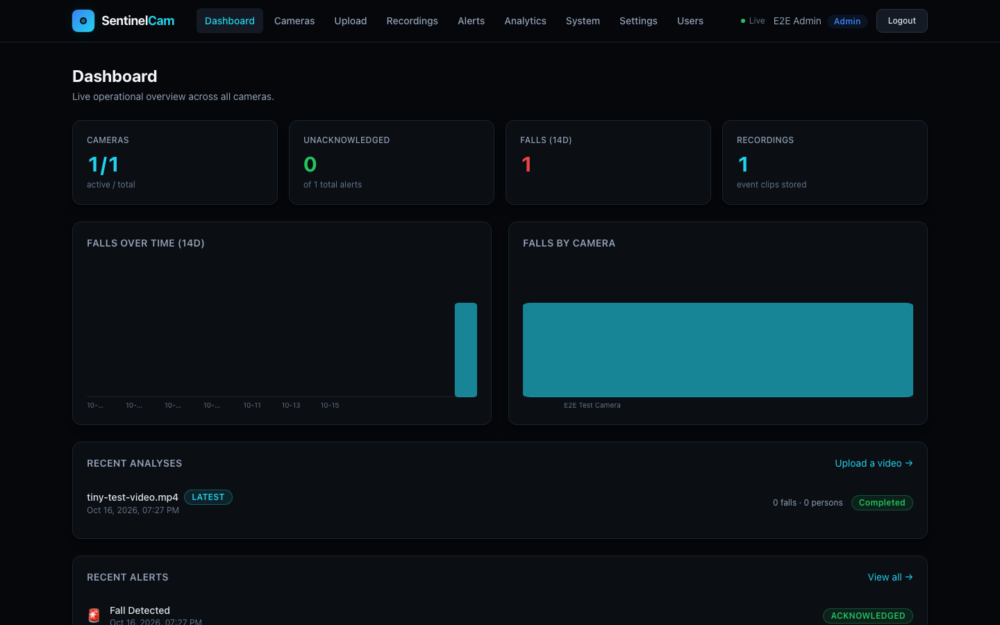
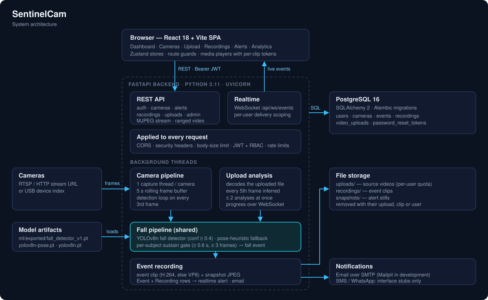
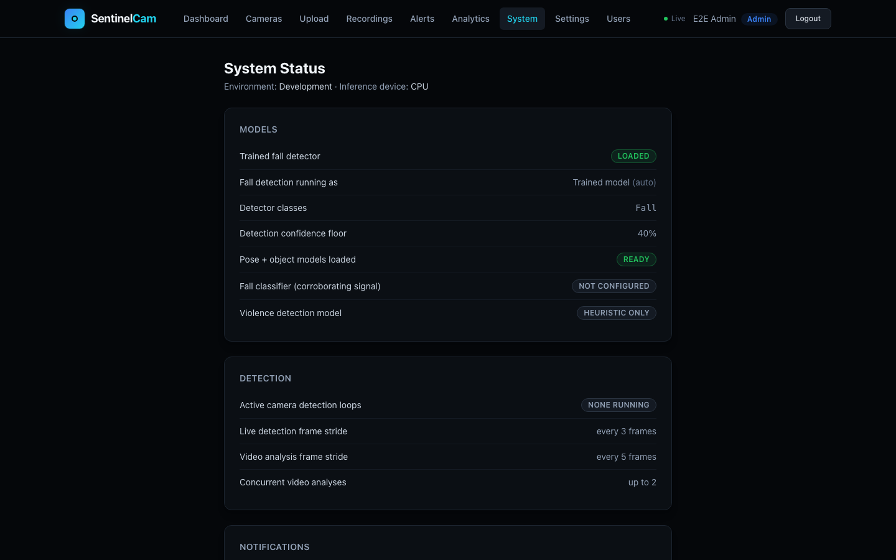
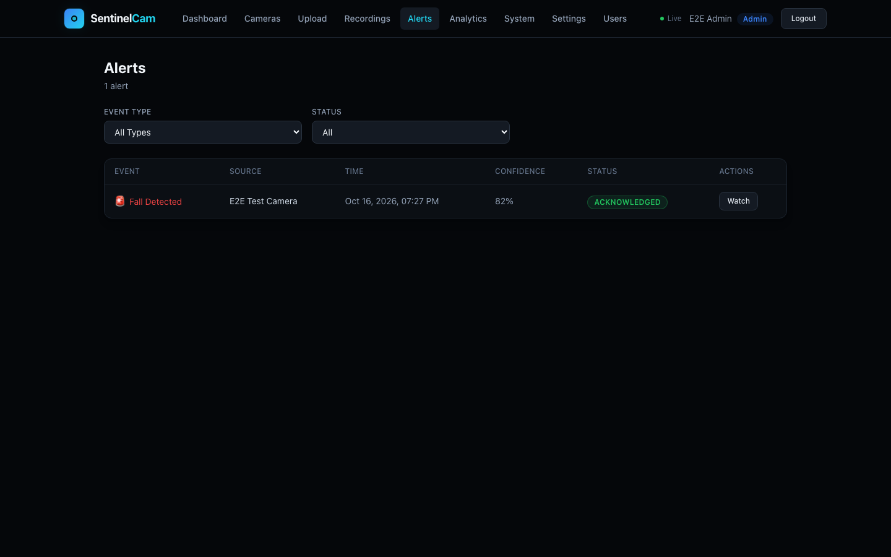
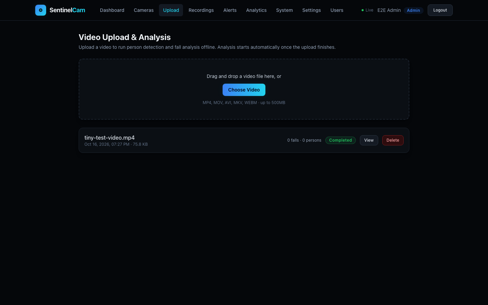
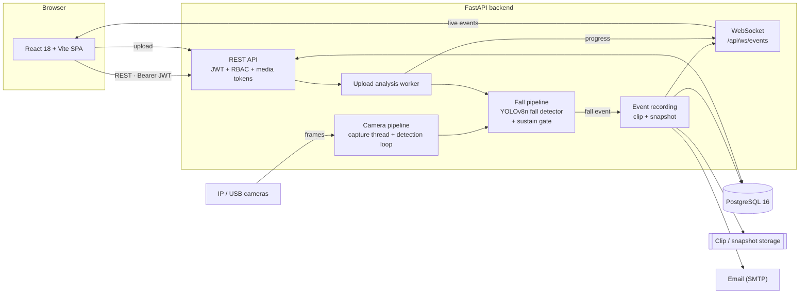
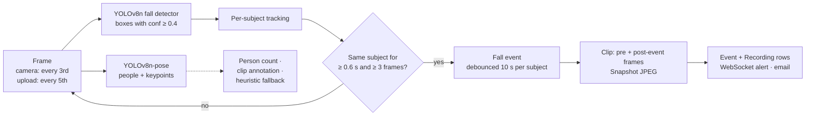
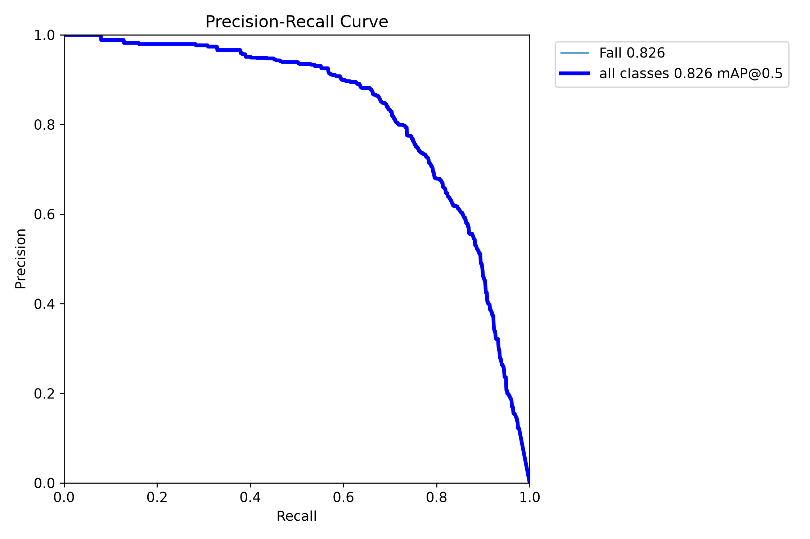
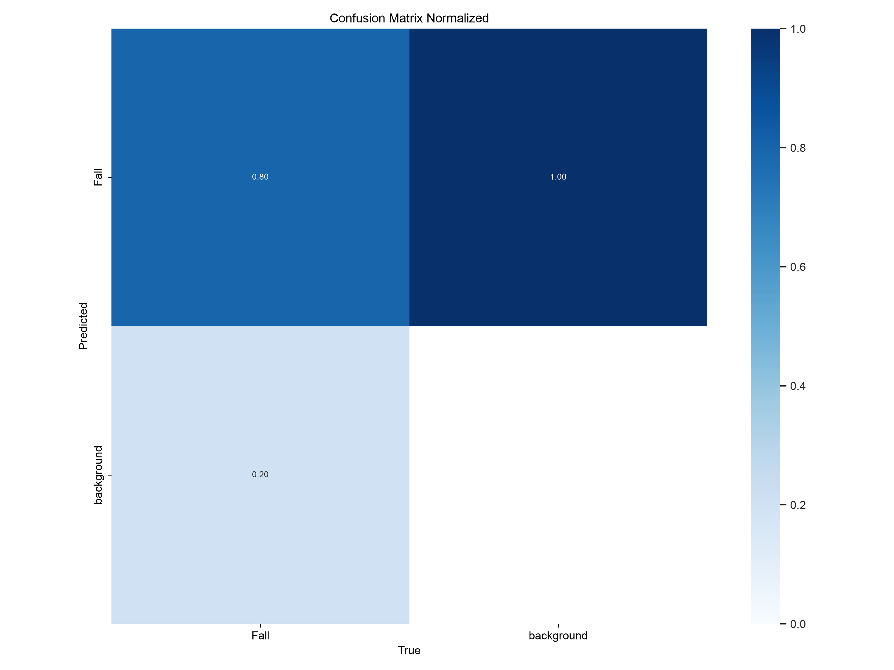

<div align="center">

# SentinelCam

**Computer-vision fall detection for camera feeds and recorded video — a full-stack system that
turns frames into reviewed, evidence-backed alerts.**

[](https://github.com/longlivewama/SentinelCam/actions/workflows/ci.yml)
[](LICENSE)
[](https://www.python.org/)
[](https://fastapi.tiangolo.com/)
[](https://react.dev/)
[](https://www.postgresql.org/)
[](https://docs.ultralytics.com/)
[](https://docs.docker.com/compose/)

[Model card](ml/MODEL_CARD.md) · [Video-level evaluation](ml/validation/README.md) ·
[Security policy](SECURITY.md) · [Changelog](CHANGELOG.md) · [Contributing](CONTRIBUTING.md)



<sub>The SentinelCam dashboard. Real application screenshot, captured from a local stack populated
with the end-to-end suite's synthetic seed data — no real footage or personal data.</sub>

</div>

---

## Why SentinelCam

In care homes, hospitals and industrial sites, the harm done by a fall depends heavily on **how
long the person lies there before anyone notices**. The cameras are often already installed; what
is missing is something watching them.

SentinelCam is that layer. It reads frames from IP/USB cameras or from an uploaded video file,
runs a fine-tuned YOLOv8 fall detector over them, and when a fall persists it does what a human
operator would: records a clip of what just happened, saves a still, raises an alert in the browser
in real time, and emails the people on call. Operators then review, play back and acknowledge the
event.

> [!IMPORTANT]
> SentinelCam is an engineering project, **not a certified medical or safety device**. On the small
> video evaluation described [below](#ai-detection-pipeline) the detector caught 9 of 10 falls but
> only 9 of its 20 alerts were real falls. It is usable as a **review aid** where a person checks
> every clip; it is **not** fit for unattended alerting.

## Contents

- [Visual overview](#visual-overview)
- [Key features](#key-features)
- [System architecture](#system-architecture)
- [AI detection pipeline](#ai-detection-pipeline)
- [Technology stack](#technology-stack)
- [Quick start](#quick-start)
- [Local development](#local-development)
- [Configuration](#configuration)
- [Testing and quality assurance](#testing-and-quality-assurance)
- [Security and data handling](#security-and-data-handling)
- [Known limitations](#known-limitations)
- [Roadmap](#roadmap)
- [Repository structure](#repository-structure)
- [License and acknowledgments](#license-and-acknowledgments)

---

## Visual overview

<p align="center">
  
</p>
<p align="center"><sub>System architecture (original diagram of the components in this repository).</sub></p>

<table>
  <tr>
    <td width="50%"></td>
    <td width="50%"></td>
  </tr>
  <tr>
    <td><sub><b>System Status</b> — which detector is actually running, its thresholds, and whether
    the trained model loaded or the app fell back to the pose heuristic.</sub></td>
    <td><sub><b>Alerts</b> — filterable by event type and acknowledgement state, with in-browser
    clip playback.</sub></td>
  </tr>
  <tr>
    <td colspan="2"></td>
  </tr>
  <tr>
    <td colspan="2"><sub><b>Video upload &amp; analysis</b> — the file is validated in the browser and
    on the server, then analysed in the background by the same fall pipeline live cameras use. The
    row shown is the end-to-end suite's synthetic, person-free fixture, so 0 falls / 0 persons is
    the correct result.</sub></td>
  </tr>
</table>

All screenshots are genuine captures of the running application with synthetic seed data. **No
example detection on real footage is shown**: the footage available to this project (third-party
clips and the CC BY-NC-SA UR Fall Detection Dataset) may not be redistributed here. The
detector's [evaluation curves](#ai-detection-pipeline) are shown instead.

---

## Key features

Every feature below is implemented in this repository, and all but the crowd and violence
heuristics are exercised by automated tests. "Implemented" is not the same as "production-ready" —
see [Known limitations](#known-limitations).

**Detection and video**

- **Trained fall detector** — a fine-tuned single-class YOLOv8n model
  ([`ml/exported/fall_detector_v1.pt`](ml/exported)) is the primary fall signal, with a YOLOv8-pose
  geometric heuristic as an automatic, *reported* fallback.
- **Temporal gating** — a single frame never raises an alert; a detection must persist for the same
  tracked subject before an event fires, and repeat firings are debounced.
- **Live cameras** — RTSP/HTTP stream URLs or USB device indices; one shared capture thread per
  camera feeds the MJPEG live view, the detector and the pre-event buffer.
- **Uploaded-video analysis** — drag-and-drop upload (MP4, MOV, AVI, MKV, WebM), background
  analysis with live progress, and per-event timestamps *within the video*.
- **Event evidence** — every fall produces a playable clip (pre- and post-event footage), a snapshot
  still, and an alert row recording confidence and which detector fired. Clips from uploaded video
  are annotated with a box that follows the person who fell.
- **Additional live detectors** — crowd counting and a violence heuristic run on live cameras.
  Both are heuristics, not trained models.

**Platform**

- **Authentication** — signup, login, logout, forgot/reset password (one-time hashed reset tokens).
- **Role-based access control** — `admin` / `operator` / `viewer`, enforced server-side.
- **Per-user data isolation** — a user's uploads, their alerts and clips are visible only to them
  and to operators, over REST *and* over the WebSocket.
- **Real-time updates** — a WebSocket pushes new alerts, camera status changes and upload progress.
- **Alerts, recordings and analytics** — acknowledgement workflow, paginated and filterable
  listings, ranged in-browser playback and downloads, dashboard and analytics charts.
- **Media access control** — video and stream URLs carry a short-lived token scoped to one
  resource, never the session token.
- **Upload hardening** — extension allow-list, container-signature check, 500 MB size limit enforced
  *while the body streams in*, and a per-user storage quota.
- **Cleanup behaviour** — deleting an upload, a recording or a user removes the associated clips,
  snapshots and directories, not only the database rows.
- **Operations** — a System Status page, email notifications (SMS/WhatsApp are interface stubs),
  per-IP rate limits on auth endpoints, Alembic migrations, and a one-command Docker Compose stack.

---

## System architecture



| Component | Responsibility | Code |
|---|---|---|
| **Frontend** | React SPA served by nginx in Docker. Role-aware routes, Zustand stores, a WebSocket client that stops reconnecting with an expired token, media players that mint per-clip tokens. | [`frontend/src`](frontend/src) |
| **REST API** | Auth, cameras, alerts, recordings, uploads, analytics, admin and system routes. Every JSON route takes the session JWT **only** as an `Authorization: Bearer` header. | [`backend/app/api/routes`](backend/app/api/routes) |
| **Request middleware** | CORS, security headers (`nosniff`, `DENY`, `no-referrer`), and a request-body limit that refuses an oversized upload before it is spooled to disk. | [`backend/app/core/http_hardening.py`](backend/app/core/http_hardening.py) |
| **Camera pipeline** | One capture thread per camera keeps the latest JPEG (for the MJPEG view) and a 5-second rolling frame buffer. A per-camera detection loop runs every 3rd frame. | [`stream_manager.py`](backend/app/services/stream_manager.py), [`engine.py`](backend/app/services/detection/engine.py) |
| **Upload analysis** | A background worker decodes the uploaded file, runs inference on every 5th frame, reports progress, and writes one clip per fall. At most 2 analyses run at once; the rest queue. | [`video_analysis.py`](backend/app/services/video_analysis.py) |
| **Fall pipeline** | Selects the strategy (`auto` / `model` / `heuristic` / `hybrid`) once, and is shared by both video sources so uploads exercise the production detector. | [`fall_pipeline.py`](backend/app/services/detection/fall_pipeline.py) |
| **Event recording** | Writes the clip through a codec ladder (H.264 → VP8 → VP9 → MPEG-4), saves a snapshot, persists `Recording` + `Event` rows, publishes a realtime alert and emails recipients. | [`recording_engine.py`](backend/app/services/recording_engine.py) |
| **Realtime** | An in-process broadcaster bridges worker threads to WebSocket clients, delivering each event only to the users entitled to see it. | [`realtime.py`](backend/app/services/realtime.py) |
| **Persistence** | PostgreSQL via SQLAlchemy 2; schema managed by Alembic. Files live under `storage/{uploads,recordings,snapshots}` (Docker named volumes in Compose). | [`backend/app/models`](backend/app/models), [`backend/alembic`](backend/alembic) |

---

## AI detection pipeline

### From frame to alert



1. **Frames.** Live cameras are sampled every 3rd frame (`DETECTION_FRAME_STRIDE`); uploaded files
   every 5th (`VIDEO_ANALYSIS_FRAME_STRIDE`). Upload timestamps are measured on the video's own
   timeline, so the gate behaves identically however fast the host decodes.
2. **Detection.** The trained YOLOv8n `Fall` detector returns boxes above
   `FALL_DETECTOR_MIN_CONFIDENCE` (default 0.4). A YOLOv8n-pose model runs alongside it to count
   people, to annotate upload clips, and to drive the heuristic fallback.
3. **Temporal gate.** Boxes are associated with tracked subjects, and an event fires only when the
   same subject has been detected for at least `FALL_DETECTOR_MIN_SUSTAINED_SECONDS` (0.6 s) **and**
   `FALL_DETECTOR_MIN_CONSECUTIVE_FRAMES` (3) processed frames. Each subject is then debounced for
   10 s. The pose heuristic instead requires 1.2 s of sustained lying posture.
4. **Evidence.** Live-camera clips combine 5 s from the rolling buffer with 5 s collected after the
   event (`PRE_EVENT_SECONDS` / `POST_EVENT_SECONDS`); upload clips span 3 s either side. Each clip
   gets a snapshot still.
5. **Delivery.** The event is stored with its confidence, its detector (`model` or `heuristic`) and,
   for uploads, its position in the footage. It is then pushed to entitled browsers and emailed.

`FALL_DETECTION_MODE=auto` (the default) uses the trained model when it loads and otherwise falls
back to the pose heuristic. That fallback is never silent: `GET /api/system/status` and the System
Status page report both the configured and the active mode.

**Upload-clip annotation.** Clips written from uploaded video carry a box over the person who fell,
labelled `FALL DETECTED` with a temporary track id and the event's confidence. Annotation runs no
extra inference and cannot create, suppress or retime an event. When no tracked person can be
confidently associated with the detection, the detector's own region is drawn dashed and labelled
`UNMATCHED`. Track ids live for seconds within one analysis; there is no face or identity
recognition. Live-camera clips are not annotated.

### The model

`ml/exported/fall_detector_v1.pt` is a YOLOv8n detector (3.2 M parameters, 5.4 MB) fine-tuned for
80 epochs from COCO weights on the Roboflow `voc-fall-person_falls` dataset (CC BY 4.0), prepared
into 11,074 train / 2,189 validation / 2,176 test images. Its frame-level metrics on still images,
from [`ml/MODEL_CARD.md`](ml/MODEL_CARD.md):

| Split | Precision | Recall | mAP@50 | mAP@50-95 |
|---|---:|---:|---:|---:|
| Validation (2,189 images) | 0.812 | 0.710 | 0.826 | 0.528 |
| Held-out test (2,176 images) | 0.846 | 0.800 | 0.877 | 0.557 |

<p align="center">
  
  
</p>
<p align="center"><sub>Precision–recall curve and normalized confusion matrix produced by the
training run (validation split). Frame-level, on still images.</sub></p>

### Video-level evaluation (limited)

Frame-level metrics do not describe an alerting system. [`ml/validation/`](ml/validation/README.md)
drives the production inference path over labelled clips and measures incidents instead. The only
corpus run so far is small: **20 clips from the UR Fall Detection Dataset — 10 falls and 10
activities of daily living, 1.8 minutes in total, one subject, one viewpoint, two rooms.**

| Measure | Result |
|---|---:|
| Incident recall | 90% (9 of 10 falls) |
| Alerts that were real falls (incident precision) | 45% (9 of 20) |
| Mean detection latency | 0.63 s |
| False alerts per hour of ordinary activity | ≈ 574 (extrapolated from about 1 minute of footage) |

These figures were reproduced with fresh inference (`--no-cache`) on 2026-10-16, on CPU, with the
committed weights. Treat them as **indicative only**: the sample is tiny, and the false-alert rate is
an extrapolation, not a benchmark. The direction is nevertheless clear. On ordinary activity the
detector emits `Fall` boxes as often, and as confidently, as on real falls, so no confidence or
duration threshold separates them — fixing it needs retraining with hard negatives. Reproduce with:

```bash
cd backend && source venv/bin/activate && cd ..
python -m ml.validation.fetch_urfd      # downloads the clips locally; not redistributed here
python -m ml.validation.evaluate --no-cache
```

Full methodology, the dataset the evaluation *should* use, and its current coverage gaps are in
[`ml/validation/README.md`](ml/validation/README.md) and [`ml/MODEL_CARD.md`](ml/MODEL_CARD.md).

---

## Technology stack

| Layer | Technology |
|---|---|
| **Frontend** | React 18, Vite 5, React Router 6, Zustand 4, Axios, Tailwind CSS 3 |
| **Backend** | Python 3.11, FastAPI 0.141, Starlette 1.6, Uvicorn, Pydantic 2 |
| **Database** | PostgreSQL 16, SQLAlchemy 2.0, Alembic |
| **Computer vision** | Ultralytics 8.3 (YOLOv8n detection and pose), PyTorch (CPU build in Docker), OpenCV 4.10 |
| **Auth** | JWT HS256 (python-jose), bcrypt (passlib), resource-scoped media tokens |
| **Realtime** | FastAPI / Starlette WebSocket |
| **Notifications** | SMTP email; Mailpit as the development mail catcher |
| **Testing** | pytest (against real PostgreSQL), Vitest + Testing Library, Playwright |
| **Quality / CI** | ruff, ESLint, GitHub Actions (lint, tests, build, E2E, dependency audit, credential scan) |
| **Packaging** | Docker, Docker Compose, nginx (static frontend) |

---

## Quick start

**Prerequisites:** Docker with Docker Compose. Nothing else is required for the containerised stack.

```bash
git clone https://github.com/longlivewama/SentinelCam.git
cd SentinelCam
cp .env.example .env           # optional: every value has a local default
docker compose up --build
```

Then, in a second terminal, create the first administrator (it prompts for an email and password):

```bash
docker compose exec backend python seed_admin.py
```

| Service | Default URL |
|---|---|
| Web application | http://localhost:5173 |
| API and interactive docs (disabled when `ENVIRONMENT=production`) | http://localhost:8000 · http://localhost:8000/docs |
| Mailpit — catches alert and password-reset emails | http://localhost:8025 |

Ports are configurable through `FRONTEND_PORT`, `BACKEND_PORT`, `POSTGRES_PORT` and `MAILPIT_*` in
`.env`. Log in, then go to **Upload** to analyse a video (no camera needed), or add a camera on the
**Cameras** page with an `rtsp://…` URL or a USB device index such as `0`.

> [!NOTE]
> **Upgrading an existing database.** The backend container runs `alembic upgrade head` on every
> start. A database created before migration `f4a1c9e6b230` (which adds `cameras.deleted_at`) is
> therefore migrated the first time a newer image starts. The migration only adds a nullable column,
> but back up any database holding data you care about before rebuilding.

> [!TIP]
> USB cameras generally cannot be passed through Docker Desktop on macOS or Windows. Run the
> backend outside Docker for local webcam testing; RTSP cameras work either way.

Recordings, snapshots and uploads persist in named Docker volumes. `docker compose down -v` deletes
them **and the database**.

---

## Local development

**Prerequisites:** Python 3.11, Node 22 (the version CI uses; jsdom 30 needs a recent Node), and a
local PostgreSQL server.

```bash
# Databases
createdb sentinelcam
createdb sentinelcam_test                 # used by the backend test suite only

# Backend — http://localhost:8000
cd backend
python3.11 -m venv venv && source venv/bin/activate
pip install -r requirements.txt
cp .env.example .env                      # set DATABASE_URL, JWT_SECRET_KEY, SMTP_* …
alembic upgrade head
python seed_admin.py
uvicorn app.main:app --reload

# Frontend — http://localhost:5173 (separate terminal)
cd frontend
npm ci
cp .env.example .env                      # VITE_API_URL=http://localhost:8000
npm run dev
```

The base YOLO weights (`yolov8n.pt`, `yolov8n-pose.pt`) are downloaded by Ultralytics on first use
and are gitignored. The trained fall detector is committed and loaded from `ml/exported/` by
default. More detail: [`backend/README.md`](backend/README.md), [`frontend/README.md`](frontend/README.md).

---

## Configuration

All configuration comes from environment variables. Only `.env.example` templates are committed;
real `.env` files are gitignored. **Never commit real secrets.**

| Variable | Purpose |
|---|---|
| `JWT_SECRET_KEY` | Signing secret. The backend **refuses to start** with the placeholder when `ENVIRONMENT=production`. Generate one with `python3 -c "import secrets; print(secrets.token_hex(32))"` |
| `ENVIRONMENT` | `development` · `test` · `production` (production also hides `/docs`) |
| `DATABASE_URL`, `POSTGRES_PASSWORD` | PostgreSQL connection |
| `CORS_ORIGINS`, `FRONTEND_URL`, `VITE_API_URL` | Allowed browser origins, links in emails, the API base URL baked into the frontend build |
| `NOTIFICATION_CHANNELS`, `SMTP_*`, `ALERT_RECIPIENTS` | Email delivery |
| `MAX_UPLOAD_SIZE_MB` (500), `MAX_UPLOAD_STORAGE_PER_USER_MB` (5000), `ALLOWED_VIDEO_EXTENSIONS` | Upload limits |
| `MAX_CONCURRENT_VIDEO_ANALYSES` (2) | Concurrent upload analyses; the rest queue |
| `FALL_DETECTION_MODE` (`auto`), `FALL_DETECTOR_MODEL_PATH` | Detection strategy and checkpoint |
| `FALL_DETECTOR_MIN_CONFIDENCE` (0.4), `FALL_DETECTOR_MIN_SUSTAINED_SECONDS` (0.6), `FALL_DETECTOR_MIN_CONSECUTIVE_FRAMES` (3) | The alerting gate |
| `DETECTION_FRAME_STRIDE` (3), `VIDEO_ANALYSIS_FRAME_STRIDE` (5), `PRE_EVENT_SECONDS` / `POST_EVENT_SECONDS` (5 / 5) | Sampling and clip length for live cameras |
| `MEDIA_TOKEN_EXPIRE_SECONDS` (300), `JWT_EXPIRE_HOURS` (24) | Token lifetimes |
| `AUTH_*_MAX_REQUESTS`, `AUTH_*_WINDOW_SECONDS` | Per-IP rate limits on signup, login, forgot- and reset-password |

The commented templates are [`.env.example`](.env.example), [`backend/.env.example`](backend/.env.example)
and [`frontend/.env.example`](frontend/.env.example).

---

## Testing and quality assurance

### Commands

```bash
# Backend: unit, API and integration tests against a real PostgreSQL database
cd backend && source venv/bin/activate
ruff check .
pytest                       # needs the sentinelcam_test database (see backend/tests/conftest.py)

# Frontend: lint, unit and component tests, production build
cd frontend
npm run lint && npm test && npm run build

# Browser end-to-end tests (Playwright) — see the warning below first
cd e2e && npm install && npx playwright install chromium && npm test
```

> [!WARNING]
> `cd e2e && npm test` starts the **default** Docker Compose project and its seeder **truncates
> every table**. On a machine where that stack holds data you care about, run it under a separate
> `COMPOSE_PROJECT_NAME`, or use `E2E_SKIP_DOCKER=1` against a scratch database — see
> [`e2e/README.md`](e2e/README.md). The backend suite refuses to run against any database whose
> name does not mark it as a test database.

### Verified results

Results from runs on **2026-10-16** (Apple M5, macOS, CPU inference) against this revision:

| Suite | What it covers | Result |
|---|---|---|
| **Backend** — pytest + ruff | Security primitives, auth and RBAC, cross-user isolation, media tokens, upload validation and body limits, pagination, Range requests, realtime scoping, cascade deletes and file cleanup, camera stream resource handling, Alembic migrations and schema drift, the fall-detection gates, the committed model artifact, and an analysis over a real decoded video | **696 passed**, 0 failed; ruff clean |
| **Frontend** — Vitest + ESLint | Auth pages, route guards, media-token minting and failure states, pagination and filters, upload workflow, results screen, system status, stores | **121 passed**, 0 failed; ESLint 0 problems |
| **Production build** — Vite | Frontend bundle | Succeeded |
| **End-to-end** — Playwright, Chromium | Signup, login, logout, password reset through a real email, camera CRUD and RBAC, alert acknowledgement, in-browser clip decoding, and upload → analyse → results | **18 passed**, against an isolated local backend and scratch database |
| **AI evaluation** | 20 labelled URFD clips through the production inference path | Reproduced the figures [above](#video-level-evaluation-limited) |

**Not verified by these runs:** Docker image builds, physical or RTSP cameras, GPU inference, real
SMTP delivery, multi-worker deployment, long-video memory use, and production deployment. No code
coverage percentage is published because none has been measured.

---

## Security and data handling

Implemented controls:

- **Authentication** — bcrypt password hashes; JWTs accepted only in the `Authorization` header on
  JSON routes; single-use password-reset tokens stored only as SHA-256 hashes, with every other
  outstanding token invalidated on use.
- **Authorization** — role checks on every mutating route, plus row-level scoping
  ([`app/core/scoping.py`](backend/app/core/scoping.py)) so upload-derived alerts, clips and realtime
  events reach only their owner and operators. The frontend's route guards are UX, not security.
- **Media tokens** — `<video>`, `` and download URLs carry a token scoped to one resource,
  valid for 5 minutes, without a role, and refused everywhere else; `token=` values are redacted
  from every log record.
- **Uploads** — extension allow-list, a container-signature check on the file's bytes, server-side
  filenames (no client-controlled paths), a containment check when serving, a request-body limit
  enforced while the body streams, and a per-user quota.
- **Abuse limits** — per-IP rate limits on auth endpoints; bounded pagination; bounded concurrent
  analyses; camera credentials embedded in RTSP URLs are hidden from viewer accounts.
- **Deployment hygiene** — the startup guard against the default JWT secret, security headers,
  interactive docs disabled in production, Postgres and Mailpit bound to loopback in Compose, a
  non-root backend container, and CI scans for committed `.env` files and credential-shaped strings.
- **Data cleanup** — deleting an upload, recording or user removes its source video, clips,
  snapshots and per-upload directories.

Limitations: the realtime WebSocket still authenticates with the session token in its handshake
URL (mitigated by log redaction, identity-scoped delivery and closing the socket at token expiry);
the rate limiter and broadcaster are in-memory and per-process; and `pip-audit` reports advisories
in `ecdsa`, `pyasn1` and `python-jose` that do not apply to this app's HS256-only configuration but
remain unpatched upstream. Several frontend build-time dev dependencies also carry advisories whose
fixes require major-version upgrades. This project has had local reviews, **not an independent
security audit**. Report vulnerabilities privately as described in [SECURITY.md](SECURITY.md).

---

## Known limitations

**Confirmed**

1. **High false-alert rate.** On the limited video evaluation, 11 of 20 alerts were not falls. The
   detector is a review aid, not an unattended alarm, and needs retraining with hard negatives
   (people lying down, sitting, crouching) — see [`ml/MODEL_CARD.md`](ml/MODEL_CARD.md).
2. **Training data is not deployment data.** The training images are mostly web stills, not
   care-home or hospital camera footage.
3. **Analysis is slower than real time on CPU.** A previous measurement (Apple M5, backend limited
   to 4 CPUs / 4 GB) analysed a 29.3 s, 576×1024 video in a median 36.3 s, plus about 37 s of
   one-time model loading after a restart. The Linux container has no GPU path.
4. **Violence and crowd detection are heuristics**, not trained models.
5. **Live-camera clips are not annotated** with bounding boxes; only upload clips are.
6. **Single-process design.** The rate limiter and realtime broadcaster are in-memory, so running
   several backend workers needs a shared store such as Redis.
7. **`HEAD` requests to media endpoints return 405.** Browsers use ranged `GET`, so playback is
   unaffected.

**Unverified risks**

- Upload analysis buffers full-resolution frames for each pending clip; very high-resolution
  videos with several falls close together could use a lot of memory. Not measured.
- The YOLO model instances are shared across analysis threads. No divergence was observed when 4
  analyses ran in parallel, but this is not a guarantee under every load.
- Real RTSP cameras, SMS/WhatsApp delivery (stubbed) and production deployment have not been
  exercised.

---

## Roadmap

Planned work, none of which exists yet:

- Retrain the fall detector with hard negatives and evaluate it on a larger, more varied labelled
  video corpus ([specification](ml/validation/README.md)).
- GPU or batched inference for faster analysis of long recordings.
- A Redis-backed rate limiter and broadcaster for multi-worker deployments.
- A renewable, scoped WebSocket token to replace the session token in the handshake URL.
- Bounding-box annotation for live-camera clips.
- SMS/WhatsApp providers behind the existing notifier interface.
- A documented production deployment reference (managed Postgres, object storage, TLS).

---

## Repository structure

```text
SentinelCam/
├── backend/                     FastAPI service
│   ├── app/
│   │   ├── api/routes/          auth, cameras, alerts, recordings, video_uploads,
│   │   │                        analytics, admin, realtime, system
│   │   ├── core/                security, dependencies, scoping, pagination,
│   │   │                        rate limiting, HTTP hardening, log redaction
│   │   ├── models/ schemas/     SQLAlchemy models and Pydantic schemas
│   │   └── services/            stream manager, recording engine, video analysis,
│   │       ├── detection/       fall pipeline, trained detector, pose heuristic,
│   │       │                    tracking and clip annotation, crowd, violence
│   │       └── notifications/   email notifier and SMS/WhatsApp stubs
│   ├── alembic/                 database migrations
│   ├── scripts/                 retention cleanup, codec backfill, E2E seeding
│   └── tests/                   pytest suite (real PostgreSQL)
├── frontend/                    React + Vite SPA (pages, components, stores, lib)
├── e2e/                         Playwright suite and fixtures
├── ml/                          training and evaluation pipeline (not imported by the app)
│   ├── detector/                dataset download, analysis, preparation, training
│   ├── validation/              video-level evaluation framework
│   ├── exported/                committed model artifacts and metadata
│   ├── reports/                 evaluation reports and training curves
│   └── MODEL_CARD.md
├── docs/images/                 README screenshots and architecture diagram
├── .github/workflows/ci.yml     CI pipeline
├── docker-compose.yml           postgres · mailpit · backend · frontend
└── .env.example                 configuration template
```

Datasets, training runs, logs and base YOLO weights are deliberately **not** in Git — see
[`ml/README.md`](ml/README.md) for how to recreate them.

---

## License and acknowledgments

SentinelCam's own code is released under the [MIT License](LICENSE). Third-party components keep
their own terms, which the MIT license does not override — see [NOTICE.md](NOTICE.md):

- **Ultralytics YOLOv8** is licensed under **AGPL-3.0**; `fall_detector_v1.pt` is fine-tuned from
  Ultralytics weights. Review Ultralytics' licensing before any commercial use.
- The fall-detection training data is the Roboflow `tfmbigdata2025/voc-fall-person_falls` export,
  **CC BY 4.0**.
- The video evaluation uses the **UR Fall Detection Dataset** (Kwolek & Kępski, 2014), CC BY-NC-SA
  4.0. It is downloaded locally by the evaluation scripts and is not redistributed here.

Contributions are welcome — see [CONTRIBUTING.md](CONTRIBUTING.md).
