<div align="center">

# SentinelCam

**AI video analytics for fall detection: person detection, human pose estimation and multi-person
tracking over live camera feeds and uploaded video, in a full-stack FastAPI + React application
that turns frames into reviewable, evidence-backed events.**

[](https://github.com/longlivewama/SentinelCam/actions/workflows/ci.yml)
[](LICENSE)
[](https://www.python.org/)
[](https://fastapi.tiangolo.com/)
[](https://react.dev/)
[](https://www.postgresql.org/)
[](https://docs.ultralytics.com/)
[](https://docs.docker.com/compose/)

[Model card](ml/MODEL_CARD.md) · [Video-level evaluation](ml/validation/README.md) ·
[Security policy](SECURITY.md) · [Changelog](CHANGELOG.md) · [Contributing](CONTRIBUTING.md)

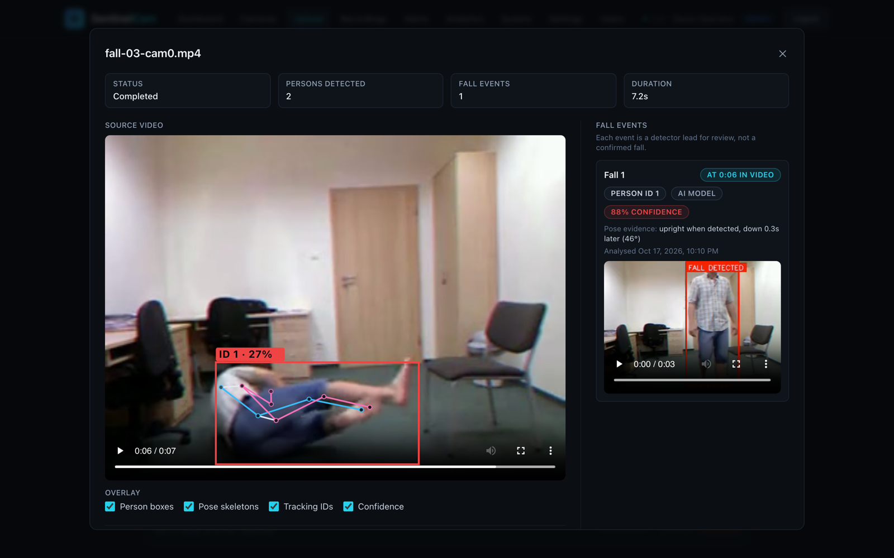

<sub>An uploaded video after analysis: the pose skeleton, box and track ID of the person the fall
was attributed to, highlighted for the moments around the event, beside the event's evidence.
Genuine screenshot of the application running locally with real model inference, on a clip from
the UR Fall Detection Dataset (CC BY-NC-SA 4.0, see <a href="NOTICE.md">NOTICE.md</a>).</sub>

</div>

---

## Why SentinelCam

In care homes, hospitals and industrial sites, the harm done by a fall depends heavily on **how
long the person lies there before anyone notices**. The cameras are often already installed; what
is missing is something watching them.

SentinelCam is that layer. It reads frames from IP/USB cameras or from an uploaded video file,
runs a fine-tuned YOLOv8 fall detector over them, and when a fall persists it does what a human
operator would: records a clip of what just happened, saves a still, raises an alert in the browser
in real time, and emails the people on call. Operators then review, play back and acknowledge the
event.

> [!IMPORTANT]
> SentinelCam is an engineering project, **not a certified medical or safety device**. On the small
> video evaluation described [below](#pose-and-tracking-in-fall-detection) (20 URFD clips), the
> default configuration caught all 10 falls but 6 of its 16 alerts were not falls, mostly people
> deliberately lying down. It is usable as a **review aid** where a person checks every clip; it is
> **not** fit for unattended alerting, and 20 clips are far too few to claim real-world accuracy.

## Contents

- [Visual overview](#visual-overview)
- [Key features](#key-features)
- [System architecture](#system-architecture)
- [AI detection pipeline](#ai-detection-pipeline)
- [Pose estimation and multi-person tracking](#pose-estimation-and-multi-person-tracking)
- [API overview](#api-overview)
- [Technology stack](#technology-stack)
- [Quick start](#quick-start)
- [Local development](#local-development)
- [Configuration](#configuration)
- [Testing and quality assurance](#testing-and-quality-assurance)
- [Security and data handling](#security-and-data-handling)
- [Troubleshooting](#troubleshooting)
- [Known limitations](#known-limitations)
- [Roadmap](#roadmap)
- [Repository structure](#repository-structure)
- [License and acknowledgments](#license-and-acknowledgments)

---

## Visual overview

<p align="center">
  
</p>
<p align="center"><sub>System architecture (original diagram of the components in this repository).</sub></p>

<table>
  <tr>
    <td width="50%">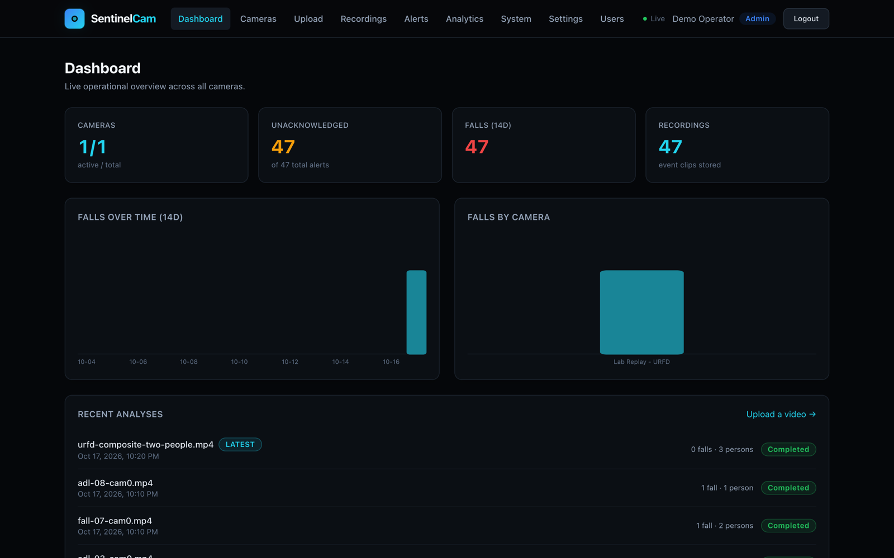</td>
    <td width="50%">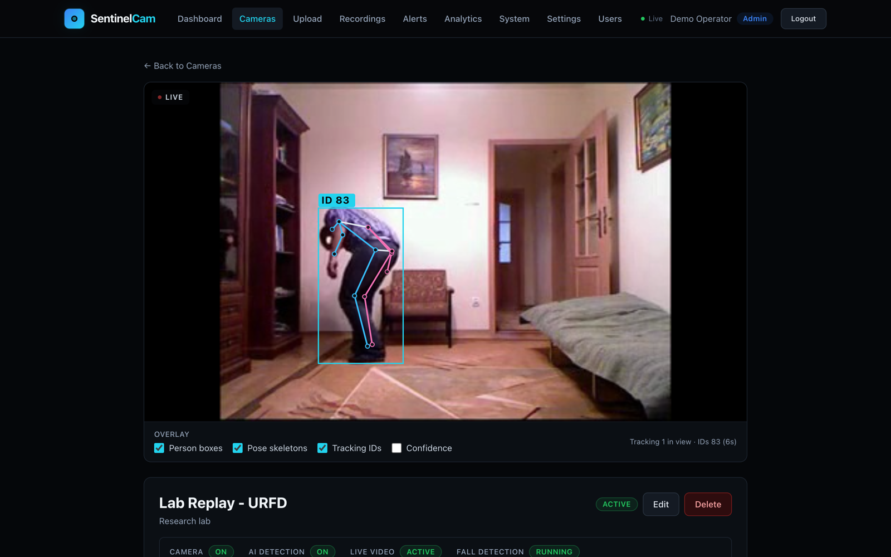</td>
  </tr>
  <tr>
    <td><sub><b>Dashboard</b> — camera, alert, fall and recording counts, fall history, and recent
    analyses. Every value comes from the API; the demo data is real detector output.</sub></td>
    <td><sub><b>Live camera</b> — boxes, 17-keypoint skeletons and track IDs over the stream,
    updated on every processed frame; each layer can be toggled.</sub></td>
  </tr>
  <tr>
    <td>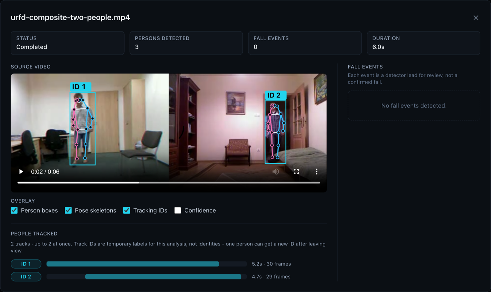</td>
    <td>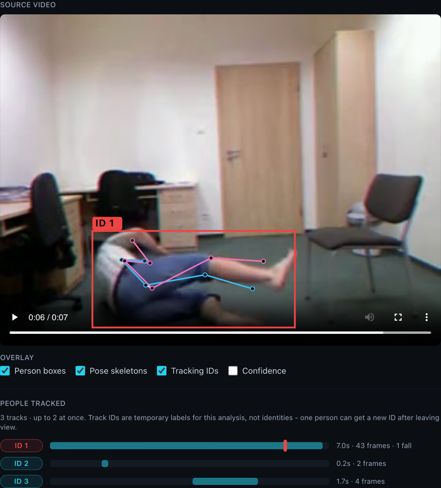</td>
  </tr>
  <tr>
    <td><sub><b>Multi-person tracking</b> — each person keeps an ID for the whole analysis, and the
    per-person timeline shows when each was seen. (Two URFD clips side by side in one frame.)</sub></td>
    <td><sub><b>Per-person timeline</b> — click a bar or a fall marker to seek the video there. The
    two short tracks are real fragmentation of the same person (see
    <a href="#known-limitations">limitations</a>).</sub></td>
  </tr>
  <tr>
    <td>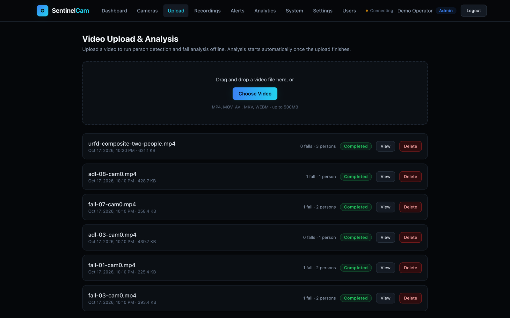</td>
    <td>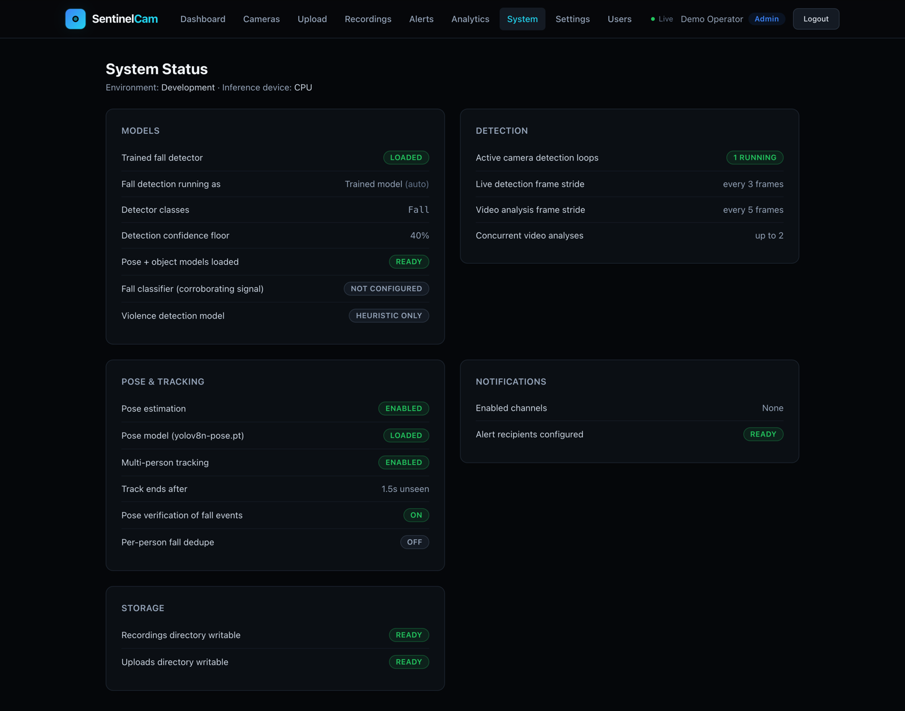</td>
  </tr>
  <tr>
    <td><sub><b>Upload &amp; analysis</b> — files are validated in the browser and on the server,
    then analysed in the background by the same pipeline the live cameras use.</sub></td>
    <td><sub><b>System Status</b> — which models actually loaded, which fall strategy is running,
    and the pose, tracking and verification settings in effect.</sub></td>
  </tr>
</table>

All screenshots are genuine captures of the application running locally, with real model inference
on clips from the UR Fall Detection Dataset (CC BY-NC-SA 4.0; images with video frames are under
that licence, see [NOTICE.md](NOTICE.md)). The live camera is a URFD clip replayed over a local
MJPEG stream. Nothing is mocked: the counts include the detector's false alarms on the replay's
everyday-activity clips. There is no hosted demo; the application runs locally.

---

## Key features

Every feature below is implemented in this repository, and all but the crowd and violence
heuristics are exercised by automated tests. "Implemented" is not the same as "production-ready" —
see [Known limitations](#known-limitations).

**Detection and video**

- **Trained fall detector** — a fine-tuned single-class YOLOv8n model
  ([`ml/exported/fall_detector_v1.pt`](ml/exported)) is the primary fall signal, with a YOLOv8-pose
  geometric heuristic as an automatic, *reported* fallback.
- **Temporal gating** — a single frame never raises an alert; a detection must persist for the same
  tracked subject before an event fires, and repeat firings are debounced.
- **Live cameras** — RTSP/HTTP stream URLs or USB device indices; one shared capture thread per
  camera feeds the MJPEG live view, the detector and the pre-event buffer.
- **Uploaded-video analysis** — drag-and-drop upload (MP4, MOV, AVI, MKV, WebM), background
  analysis with live progress, and per-event timestamps *within the video*. Uploads in a codec no
  browser decodes (e.g. MPEG-4 Part 2) get a frame-aligned playable preview, so the results player
  and its overlay still work.
- **Event evidence** — every fall produces a playable clip (pre- and post-event footage), a snapshot
  still, and an alert row recording confidence and which detector fired. Clips from uploaded video
  are annotated with a box that follows the person who fell.
- **Human pose estimation** — 17 COCO keypoints and a skeleton for every person, from the same
  YOLOv8n-pose pass that already ran on every processed frame; partially visible people get a
  partial skeleton.
- **Multi-person tracking** — persistent per-session track IDs for everyone in view, with
  tentative/confirmed states, survival through brief detection loss, and per-track lifetimes.
  Fall events are attributed to the tracked person they belong to.
- **Overlays** — boxes, skeletons, track IDs and confidence drawn over the live camera view and
  the analysed upload, each layer toggleable, aligned at any size. The person a fall was attributed
  to is highlighted in red around the event; an unattributed event highlights nobody.
- **Per-person timeline** — when each tracked person was in view, with their attributed falls;
  clicking seeks the video. Fall-event cards carry the attributed person and the pose evidence.
- **Additional live detectors** — crowd counting and a violence heuristic run on live cameras.
  Both are heuristics, not trained models.

**Platform**

- **Authentication** — signup, login, logout, forgot/reset password (one-time hashed reset tokens).
- **Role-based access control** — `admin` / `operator` / `viewer`, enforced server-side.
- **Per-user data isolation** — a user's uploads, their alerts and clips are visible only to them
  and to operators, over REST *and* over the WebSocket.
- **Real-time updates** — a WebSocket pushes new alerts, camera status changes, upload progress
  and each processed frame's tracked people.
- **Alerts, recordings and analytics** — acknowledgement workflow, paginated and filterable
  listings, ranged in-browser playback and downloads, dashboard and analytics charts.
- **Media access control** — video and stream URLs carry a short-lived token scoped to one
  resource, never the session token.
- **Upload hardening** — extension allow-list, container-signature check, 500 MB size limit enforced
  *while the body streams in*, and a per-user storage quota.
- **Cleanup behaviour** — deleting an upload, a recording or a user removes the associated clips,
  snapshots and directories, not only the database rows.
- **Operations** — a System Status page, email notifications (SMS/WhatsApp are interface stubs),
  per-IP rate limits on auth endpoints, Alembic migrations, and a one-command Docker Compose stack.

---

## System architecture

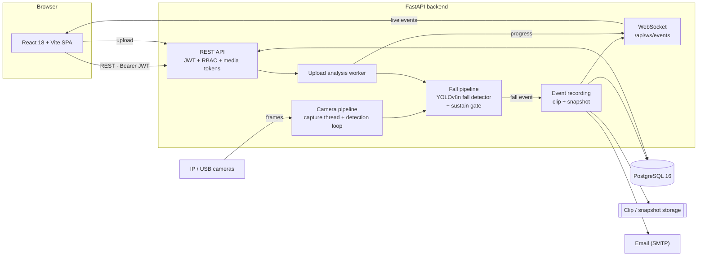

| Component | Responsibility | Code |
|---|---|---|
| **Frontend** | React SPA served by nginx in Docker. Role-aware routes, Zustand stores, a WebSocket client that stops reconnecting with an expired token, media players that mint per-clip tokens. | [`frontend/src`](frontend/src) |
| **REST API** | Auth, cameras, alerts, recordings, uploads, analytics, admin and system routes. Every JSON route takes the session JWT **only** as an `Authorization: Bearer` header. | [`backend/app/api/routes`](backend/app/api/routes) |
| **Request middleware** | CORS, security headers (`nosniff`, `DENY`, `no-referrer`), and a request-body limit that refuses an oversized upload before it is spooled to disk. | [`backend/app/core/http_hardening.py`](backend/app/core/http_hardening.py) |
| **Camera pipeline** | One capture thread per camera keeps the latest JPEG (for the MJPEG view) and a 5-second rolling frame buffer. A per-camera detection loop runs every 3rd frame. | [`stream_manager.py`](backend/app/services/stream_manager.py), [`engine.py`](backend/app/services/detection/engine.py) |
| **Upload analysis** | A background worker decodes the uploaded file, runs inference on every 5th frame, reports progress, and writes one clip per fall. At most 2 analyses run at once; the rest queue. | [`video_analysis.py`](backend/app/services/video_analysis.py) |
| **Fall pipeline** | Selects the strategy (`auto` / `model` / `heuristic` / `hybrid`) once, and is shared by both video sources so uploads exercise the production detector. | [`fall_pipeline.py`](backend/app/services/detection/fall_pipeline.py) |
| **Event recording** | Writes the clip through a codec ladder (H.264 → VP8 → VP9 → MPEG-4), saves a snapshot, persists `Recording` + `Event` rows, publishes a realtime alert and emails recipients. | [`recording_engine.py`](backend/app/services/recording_engine.py) |
| **Pose + tracking** | Turns the pose model's per-frame people into tracked people with persistent IDs and keypoints; attributes fall events to them. One tracker per camera session or video. | [`scene_tracking.py`](backend/app/services/detection/scene_tracking.py), [`pose.py`](backend/app/services/detection/pose.py) |
| **Realtime** | An in-process broadcaster bridges worker threads to WebSocket clients, delivering each event only to the users entitled to see it. | [`realtime.py`](backend/app/services/realtime.py) |
| **Persistence** | PostgreSQL via SQLAlchemy 2; schema managed by Alembic. Files live under `storage/{uploads,recordings,snapshots}` (Docker named volumes in Compose). | [`backend/app/models`](backend/app/models), [`backend/alembic`](backend/alembic) |

---

## AI detection pipeline

### From frame to alert

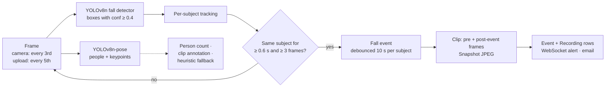

1. **Frames.** Live cameras are sampled every 3rd frame (`DETECTION_FRAME_STRIDE`); uploaded files
   every 5th (`VIDEO_ANALYSIS_FRAME_STRIDE`). Upload timestamps are measured on the video's own
   timeline, so the gate behaves identically however fast the host decodes.
2. **Detection.** The trained YOLOv8n `Fall` detector returns boxes above
   `FALL_DETECTOR_MIN_CONFIDENCE` (default 0.4). A YOLOv8n-pose model runs alongside it to count
   people, to annotate upload clips, and to drive the heuristic fallback.
3. **Temporal gate.** Boxes are associated with tracked subjects, and an event fires only when the
   same subject has been detected for at least `FALL_DETECTOR_MIN_SUSTAINED_SECONDS` (0.6 s) **and**
   `FALL_DETECTOR_MIN_CONSECUTIVE_FRAMES` (3) processed frames. Each subject is then debounced for
   10 s. The pose heuristic instead requires 1.2 s of sustained lying posture.
4. **Evidence.** Live-camera clips combine 5 s from the rolling buffer with 5 s collected after the
   event (`PRE_EVENT_SECONDS` / `POST_EVENT_SECONDS`); upload clips span 3 s either side. Each clip
   gets a snapshot still.
5. **Delivery.** The event is stored with its confidence, its detector (`model` or `heuristic`) and,
   for uploads, its position in the footage. It is then pushed to entitled browsers and emailed.
   An event held by pose verification (below) is placed in the footage where the detector fired;
   its alert goes out when it is released, up to 2 s later.

`FALL_DETECTION_MODE=auto` (the default) uses the trained model when it loads and otherwise falls
back to the pose heuristic. That fallback is never silent: `GET /api/system/status` and the System
Status page report both the configured and the active mode.

**Upload-clip annotation.** Clips written from uploaded video carry a box over the person who fell,
labelled `FALL DETECTED` with a temporary track id and the event's confidence. Annotation runs no
extra inference and cannot create, suppress or retime an event. When no tracked person can be
confidently associated with the detection, the detector's own region is drawn dashed and labelled
`UNMATCHED`. Track ids live for seconds within one analysis; there is no face or identity
recognition. Live-camera clips are not annotated.

### The model

`ml/exported/fall_detector_v1.pt` is a YOLOv8n detector (3.2 M parameters, 5.4 MB) fine-tuned for
80 epochs from COCO weights on the Roboflow `voc-fall-person_falls` dataset (CC BY 4.0), prepared
into 11,074 train / 2,189 validation / 2,176 test images. Its frame-level metrics on still images,
from [`ml/MODEL_CARD.md`](ml/MODEL_CARD.md):

| Split | Precision | Recall | mAP@50 | mAP@50-95 |
|---|---:|---:|---:|---:|
| Validation (2,189 images) | 0.812 | 0.710 | 0.826 | 0.528 |
| Held-out test (2,176 images) | 0.846 | 0.800 | 0.877 | 0.557 |

<p align="center">
  
  
</p>
<p align="center"><sub>Precision–recall curve and normalized confusion matrix produced by the
training run (validation split). Frame-level, on still images.</sub></p>

### Video-level evaluation (limited)

Frame-level metrics do not describe an alerting system. [`ml/validation/`](ml/validation/README.md)
drives the production inference path over labelled clips and measures incidents instead. The only
corpus run so far is small: **20 clips from the UR Fall Detection Dataset — 10 falls and 10
activities of daily living, 1.8 minutes in total, one subject, one viewpoint, two rooms.**

| Measure | Result |
|---|---:|
| Incident recall | 90% (9 of 10 falls) |
| Alerts that were real falls (incident precision) | 45% (9 of 20) |
| Mean detection latency | 0.63 s |
| False alerts per hour of ordinary activity | ≈ 574 (extrapolated from about 1 minute of footage) |

These figures were reproduced with fresh inference (`--no-cache`) on 2026-10-16, on CPU, with the
committed weights. Treat them as **indicative only**: the sample is tiny, and the false-alert rate is
an extrapolation, not a benchmark. The direction is nevertheless clear. On ordinary activity the
detector emits `Fall` boxes as often, and as confidently, as on real falls, so no confidence or
duration threshold separates them — fixing it needs retraining with hard negatives. Reproduce with:

```bash
cd backend && source venv/bin/activate && cd ..
python -m ml.validation.fetch_urfd      # downloads the clips locally; not redistributed here
python -m ml.validation.evaluate --no-cache
```

Full methodology, the dataset the evaluation *should* use, and its current coverage gaps are in
[`ml/validation/README.md`](ml/validation/README.md) and [`ml/MODEL_CARD.md`](ml/MODEL_CARD.md).

---

## Pose estimation and multi-person tracking

<p align="center">
  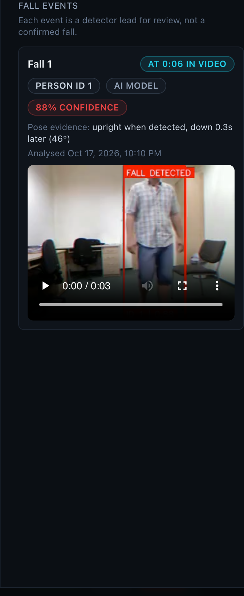
  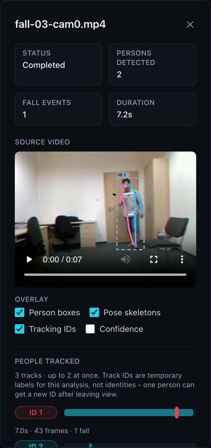
</p>
<p align="center"><sub>A fall-event card with its pose evidence and annotated clip, and the same
results view at phone width (URFD frames, CC BY-NC-SA 4.0).</sub></p>

### One inference pass, shared

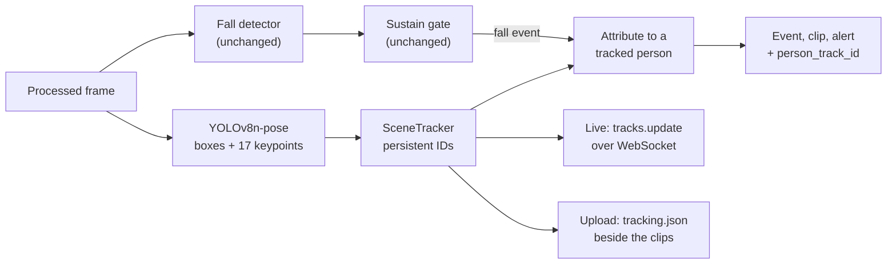

The pose model was already running on every processed frame (person counting, clip annotation, the
heuristic fallback), so it doubles as the person detector: one forward pass yields every person's
box **and** keypoints. Tracking adds no inference at all. The fall detector and its sustain gate are
untouched; tracking only labels the events they produce.

| | Choice | Why |
|---|---|---|
| **Pose model** | Ultralytics `yolov8n-pose.pt` (COCO-Keypoints, 17 points) | Already a dependency and already loaded; smallest variant for CPU real-time use. Keypoint names and skeleton come from Ultralytics itself, and a test fails if they ever diverge. |
| **Tracker** | The repository's own `PersonTracker` (greedy IoU + box-relative centre distance), wrapped by `SceneTracker` | No new dependency. Ultralytics 8.3's ByteTrack/BoT-SORT import `lap` (not installed) and fall back to a runtime `pip install`, and number tracks from one counter shared by every instance — resetting one camera's tracker would renumber the others. |

**Track IDs are temporary handles, not identities.** An ID lives inside one tracking session — one
camera detection loop or one video analysis — and a person who leaves view for longer than
`TRACKING_MAX_AGE_SECONDS` (1.5 s) comes back with a new one. A track is `tentative` until seen on
`TRACKING_MIN_HITS` (2) processed frames, `confirmed` after that, and `lost` while it is being held
open through a brief miss. Lost tracks are not drawn: their last position is stale. No face or
identity recognition is involved anywhere.

**Live cameras.** The camera's existing detection loop owns the tracker, so state cannot leak
between cameras and is released when the loop stops. Each processed frame is published as a
`tracks.update` WebSocket message (camera data, visible to every signed-in user like the stream
itself); the loop always takes the newest frame, so there is no queue to fall behind. When the loop
ends it publishes an empty update, and the client drops an overlay that stops updating after 1.5 s.
Overlays exist only while **AI detection** is on for that camera — that is what computes them.

**Uploaded videos.** Each analysis gets a fresh tracker. Every processed frame's tracked people,
each track's lifetime, and which person each fall was attributed to are written once, at the end, to
`recordings/uploads/{id}/tracking.json` — not to PostgreSQL. It is served by
`GET /api/video-uploads/{id}/tracking` under the same ownership rules as the upload, and deleted
with the upload (or its owner). Analyses made before this feature return 404 and the UI says so.
Measured size: 68 KB for a 29 s video with one or two people.

**The overlay** is an SVG whose `viewBox` is the source frame with `preserveAspectRatio="xMidYMid
meet"` — the same projection as `object-fit: contain` — laid over the same box as the video or
stream. Measured in Chromium, the drawn frame corners matched the media's picture to **0 px** at
1440×900, 1024×768 and 390×844, including a portrait camera letterboxed in a 16:9 player.

### Pose and tracking in fall detection

Every fall event is now attributed to a tracked person (`person_track_id`, or none when the
detector's box does not clearly belong to anyone — never a guess), using the same association rule
the clip annotation always used, so the event, the clip and the overlay agree. The torso angle
measured for that person over the sustain window is recorded with the event.

Two further steps can act on events the gate has already confirmed. Per-person dedupe is off
by default; **pose verification is on by default, in its deferred form** (below). The first
evaluation, of the immediate form, on the labelled URFD corpus (20 clips, 10 falls, 1.8 min;
production thresholds; run with `python -m ml.validation.compare_fall_assist`):

| Variant | Real falls caught | False alerts | Recall | Precision | F1 | False alerts/h |
|---|---:|---:|---:|---:|---:|---:|
| Baseline (no tracking) | 9 | 11 | 90% | 45% | 0.60 | 574 |
| Tracking only (attribution) | 9 | 11 | 90% | 45% | 0.60 | 574 |
| + per-person dedupe (`FALL_TRACK_DEDUPE`) | 9 | 11 | 90% | 45% | 0.60 | 574 |
| + pose verification, upright < 20° | 7 | 4 | 70% | 64% | 0.67 | 230 |
| + pose verification, upright < 30° (`FALL_POSE_VERIFICATION`) | 6 | 3 | 60% | 67% | 0.63 | 172 |

Pose verification removes most false alerts but also vetoes real falls: the detector fires 0.3–0.5 s
into a fall, while the torso is still near vertical (7.6° and 9.0° on the two lost falls). For a
fall alarm, losing 2–3 of 10 real falls is the wrong trade.

**Deferred pose verification (the default).** An event whose person is upright when the gate fires
is *held*, not vetoed. It is released as soon as that person's last two torso measurements are
non-upright, or their track ends (a person on the floor is often lost by the pose model). It is
withheld only if, after `FALL_POSE_CONFIRM_SECONDS` (2 s), the post-event measurements still have
an upright median. With too few measurements it is released: no evidence is never grounds for a
veto. Events with no attributed person are never held. The 2 s window and the existing 30°
threshold were fixed before measuring, not tuned on these clips.

Measured on the URFD corpus plus two clips outside it: a 40 s i-LIDS station platform (people
walking and standing, no fall) and a 29 s handheld phone clip of a real slip on ice (labelled
21.75–22.75 s from frame inspection; earlier stumbles that recover are not labelled falls). 22
clips, 11 falls, 3.0 min:

| Variant (upright < 30°) | Real falls caught | Missed | False alerts | Recall | Precision | F1 | Median latency |
|---|---:|---:|---:|---:|---:|---:|---:|
| Baseline (verification off) | 9 | 2 | 17 | 82% | 35% | 0.49 | 0.66 s |
| Immediate veto (`FALL_POSE_CONFIRM_SECONDS=0`) | 6 | 5 | 4 | 55% | 60% | 0.57 | 0.70 s |
| **Deferred, 2 s (default)** | **11** | **0** | **7** | **100%** | **61%** | **0.76** | 0.67 s |

On the URFD clips alone the deferred check gives 10/10 falls and 6 false alerts (baseline 9/10 and
11). All four false alerts on the station-platform clip are withheld: each person was measured
upright (median 0.7–3.8°) for the 2 s after the detector fired. Two recall gains are the same
effect: on URFD fall-02 and the ice clip the detector fired 1–2 s *before* the fall, on a still-
upright person; held, the event was released when the person actually went down.

What it cannot fix: 6 of the 7 remaining false alerts are URFD "floor activity" clips — people
deliberately lying down, which is a horizontal posture and looks like a fall to pose too. Known
risks it adds: a fall straight toward or away from the camera can leave a foreshortened torso that
measures near-vertical, and someone who falls and is back on their feet within 2 s is withheld.
Alerts on held events arrive up to 2 s later. 22 clips and 11 falls are far too few to claim a
real-world accuracy change; set `FALL_POSE_VERIFICATION=false` to alert on every detector event.

### Measured cost

Apple M5, CPU, torch 8 threads, `imgsz` 640, the 29 s 576×1024 video at stride 5 (176 processed
frames), three runs each:

| Per processed frame | Before | After |
|---|---:|---:|
| Pose inference | 21.7–23.1 ms | 22.5–23.0 ms |
| Fall pipeline (incl. detector, + tracking after) | 16.0–17.1 ms | 16.5–16.8 ms |
| Whole scan loop | 7.01–7.45 s | 7.28–7.34 s |

Tracking's overhead is within run-to-run noise. Live, a 15 fps camera at stride 3 produced about
5.3 `tracks.update` messages per second of about 2.2 KB each.

**Shared-model safety.** The pose, object and fall models are each one instance shared by every
camera loop and upload analysis. Measured: two threads making their first `predict()` on a freshly
loaded Ultralytics model at the same moment crashed one of them (`'Conv' object has no attribute
'bn'`) in 15 of 15 trials. Inference on each shared model is now serialized by a lock — 0 of 15
crashes — at no measurable throughput cost (two concurrent analyses: 9.7–10.3 s with or without).

---

## API overview

All routes are under `/api` and take the session JWT as an `Authorization: Bearer` header, except
the media routes, which take a short-lived `?token=` minted for one resource. With
`ENVIRONMENT` other than `production`, the full schema is served at `/docs`.

| Area | Endpoints |
|---|---|
| Auth | `POST /auth/signup` · `POST /auth/login` · `GET /auth/me` · `PUT /auth/settings` · `POST /auth/forgot-password` · `POST /auth/reset-password` |
| Cameras | `GET, POST /cameras` · `GET, PUT, DELETE /cameras/{id}` · `POST /cameras/{id}/media-token` · `GET /cameras/{id}/stream` (MJPEG) |
| Uploaded video | `GET, POST /video-uploads` · `GET, DELETE /video-uploads/{id}` · `GET /video-uploads/{id}/tracking` · `POST /video-uploads/{id}/media-token` · `GET /video-uploads/{id}/video` (ranged) |
| Alerts | `GET /alerts` (paged, filterable) · `GET /alerts/{id}` · `PUT /alerts/{id}/acknowledge` |
| Recordings | `GET /recordings` · `GET, DELETE /recordings/{id}` · `POST /recordings/{id}/media-token` · `GET /recordings/{id}/video` · `GET /recordings/{id}/download` |
| Analytics, system | `GET /analytics/summary` · `GET /system/status` (operator) |
| Admin | `GET, POST /admin/users` · `DELETE /admin/users/{id}` · `PUT /admin/users/{id}/role` · `PUT /admin/users/{id}/toggle` |
| Realtime | `WS /ws/events` — alerts, camera status, upload progress, `tracks.update` and `fall.bbox` |

`GET /video-uploads/{id}/tracking` returns the analysis' tracking record: each processed frame's
tracked people (box, 17 keypoints, track id, state), each track's lifetime, and which tracked
person each fall event was attributed to, with its pose evidence. It returns 404 for analyses that
have no record (not finished, made before the feature existed, or made with tracking off).

---

## Technology stack

| Layer | Technology |
|---|---|
| **Frontend** | React 18, Vite 5, React Router 6, Zustand 4, Axios, Tailwind CSS 3 |
| **Backend** | Python 3.11, FastAPI 0.141, Starlette 1.6, Uvicorn, Pydantic 2 |
| **Database** | PostgreSQL 16, SQLAlchemy 2.0, Alembic |
| **Computer vision** | Ultralytics 8.3 (YOLOv8n detection and pose), PyTorch (CPU build in Docker), OpenCV 4.10 |
| **Auth** | JWT HS256 (python-jose), bcrypt (passlib), resource-scoped media tokens |
| **Realtime** | FastAPI / Starlette WebSocket |
| **Notifications** | SMTP email; Mailpit as the development mail catcher |
| **Testing** | pytest (against real PostgreSQL), Vitest + Testing Library, Playwright |
| **Quality / CI** | ruff, ESLint, GitHub Actions (lint, tests, build, E2E, dependency audit, credential scan) |
| **Packaging** | Docker, Docker Compose, nginx (static frontend) |

---

## Quick start

**Prerequisites:** Docker with Docker Compose. Nothing else is required for the containerised stack.

```bash
git clone https://github.com/longlivewama/SentinelCam.git
cd SentinelCam
cp .env.example .env           # optional: every value has a local default
docker compose up --build
```

Then, in a second terminal, create the first administrator (it prompts for an email and password):

```bash
docker compose exec backend python seed_admin.py
```

| Service | Default URL |
|---|---|
| Web application | http://localhost:5173 |
| API and interactive docs (disabled when `ENVIRONMENT=production`) | http://localhost:8000 · http://localhost:8000/docs |
| Mailpit — catches alert and password-reset emails | http://localhost:8025 |

Ports are configurable through `FRONTEND_PORT`, `BACKEND_PORT`, `POSTGRES_PORT` and `MAILPIT_*` in
`.env`. Log in, then go to **Upload** to analyse a video (no camera needed), or add a camera on the
**Cameras** page with an `rtsp://…` URL or a USB device index such as `0`.

> [!NOTE]
> **Upgrading an existing database.** The backend container runs `alembic upgrade head` on every
> start. A database created before migration `f4a1c9e6b230` (which adds `cameras.deleted_at`) is
> therefore migrated the first time a newer image starts. The migration only adds a nullable column,
> but back up any database holding data you care about before rebuilding.

> [!TIP]
> USB cameras generally cannot be passed through Docker Desktop on macOS or Windows. Run the
> backend outside Docker for local webcam testing; RTSP cameras work either way.

Recordings, snapshots and uploads persist in named Docker volumes. `docker compose down -v` deletes
them **and the database**.

---

## Local development

**Prerequisites:** Python 3.11, Node 22 (the version CI uses; jsdom 30 needs a recent Node), and a
local PostgreSQL server.

```bash
# Databases
createdb sentinelcam
createdb sentinelcam_test                 # used by the backend test suite only

# Backend — http://localhost:8000
cd backend
python3.11 -m venv venv && source venv/bin/activate
pip install -r requirements.txt
cp .env.example .env                      # set DATABASE_URL, JWT_SECRET_KEY, SMTP_* …
alembic upgrade head
python seed_admin.py
uvicorn app.main:app --reload

# Frontend — http://localhost:5173 (separate terminal)
cd frontend
npm ci
cp .env.example .env                      # VITE_API_URL=http://localhost:8000
npm run dev
```

The base YOLO weights (`yolov8n.pt`, `yolov8n-pose.pt`) are downloaded by Ultralytics on first use
and are gitignored. The trained fall detector is committed and loaded from `ml/exported/` by
default. More detail: [`backend/README.md`](backend/README.md), [`frontend/README.md`](frontend/README.md).

---

## Configuration

All configuration comes from environment variables. Only `.env.example` templates are committed;
real `.env` files are gitignored. **Never commit real secrets.**

| Variable | Purpose |
|---|---|
| `JWT_SECRET_KEY` | Signing secret. The backend **refuses to start** with the placeholder when `ENVIRONMENT=production`. Generate one with `python3 -c "import secrets; print(secrets.token_hex(32))"` |
| `ENVIRONMENT` | `development` · `test` · `production` (production also hides `/docs`) |
| `DATABASE_URL`, `POSTGRES_PASSWORD` | PostgreSQL connection |
| `CORS_ORIGINS`, `FRONTEND_URL`, `VITE_API_URL` | Allowed browser origins, links in emails, the API base URL baked into the frontend build |
| `NOTIFICATION_CHANNELS`, `SMTP_*`, `ALERT_RECIPIENTS` | Email delivery |
| `MAX_UPLOAD_SIZE_MB` (500), `MAX_UPLOAD_STORAGE_PER_USER_MB` (5000), `ALLOWED_VIDEO_EXTENSIONS` | Upload limits |
| `MAX_CONCURRENT_VIDEO_ANALYSES` (2) | Concurrent upload analyses; the rest queue |
| `FALL_DETECTION_MODE` (`auto`), `FALL_DETECTOR_MODEL_PATH` | Detection strategy and checkpoint |
| `FALL_DETECTOR_MIN_CONFIDENCE` (0.4), `FALL_DETECTOR_MIN_SUSTAINED_SECONDS` (0.6), `FALL_DETECTOR_MIN_CONSECUTIVE_FRAMES` (3) | The alerting gate |
| `DETECTION_FRAME_STRIDE` (3), `VIDEO_ANALYSIS_FRAME_STRIDE` (5), `PRE_EVENT_SECONDS` / `POST_EVENT_SECONDS` (5 / 5) | Sampling, and clip length for live cameras (upload clips use a fixed 3 s / 3 s) |
| `POSE_ESTIMATION_ENABLED` (true), `POSE_INFERENCE_IMGSZ` (640), `POSE_KEYPOINT_MIN_CONFIDENCE` (0.3) | Pose estimation. `false` skips the pose model in uploaded-video analysis when the fall mode does not need it, so those uploads get no tracking, overlays or person count. Live cameras always run it, because violence detection works from keypoints |
| `PERSON_TRACKING_ENABLED` (true), `TRACKING_MAX_AGE_SECONDS` (1.5), `TRACKING_MIN_HITS` (2), `TRACKING_MAX_RECORDED_FRAMES` (20000) | Multi-person tracking and the per-upload tracking record |
| `FALL_POSE_VERIFICATION` (true), `FALL_POSE_UPRIGHT_MAX_DEGREES` (30), `FALL_POSE_CONFIRM_SECONDS` (2), `FALL_TRACK_DEDUPE` (false), `FALL_TRACK_DEDUPE_SECONDS` (10) | Pose/tracking assistance for fall events — see the evaluation above |
| `MEDIA_TOKEN_EXPIRE_SECONDS` (300), `JWT_EXPIRE_HOURS` (24) | Token lifetimes |
| `AUTH_*_MAX_REQUESTS`, `AUTH_*_WINDOW_SECONDS` | Per-IP rate limits on signup, login, forgot- and reset-password |

The commented templates are [`.env.example`](.env.example), [`backend/.env.example`](backend/.env.example)
and [`frontend/.env.example`](frontend/.env.example).

---

## Testing and quality assurance

### Commands

```bash
# Backend: unit, API and integration tests against a real PostgreSQL database
cd backend && source venv/bin/activate
ruff check .
pytest                       # needs the sentinelcam_test database (see backend/tests/conftest.py)

# Frontend: lint, unit and component tests, production build
cd frontend
npm run lint && npm test && npm run build

# Browser end-to-end tests (Playwright) — see the warning below first
cd e2e && npm install && npx playwright install chromium && npm test
```

> [!WARNING]
> `cd e2e && npm test` starts the **default** Docker Compose project and its seeder **truncates
> every table**. On a machine where that stack holds data you care about, run it under a separate
> `COMPOSE_PROJECT_NAME`, or use `E2E_SKIP_DOCKER=1` against a scratch database — see
> [`e2e/README.md`](e2e/README.md). The backend suite refuses to run against any database whose
> name does not mark it as a test database.

### Verified results

Results from runs on **2026-10-17** (Apple M5, macOS, CPU inference) against this revision:

| Suite | What it covers | Result |
|---|---|---|
| **Backend** — pytest + ruff | Security primitives, auth and RBAC, cross-user isolation, media tokens, upload validation and body limits, pagination, Range requests, realtime scoping, cascade deletes and file cleanup, camera stream resource handling, Alembic migrations and schema drift, the fall-detection gates, the committed model artifact, an analysis over a real decoded video, the playable-preview re-encode; pose parsing and keypoint validity, tracker persistence, loss, re-entry and session isolation, fall attribution, held-event timing and the assist steps, the live tracks feed and the tracking record API — plus **real `yolov8n-pose` inference** on a sample photo and a concurrent-first-inference regression test | **764 passed**, 0 failed; ruff clean |
| **Frontend** — Vitest + ESLint | Auth pages, route guards, media-token minting and failure states, pagination and filters, upload workflow, results screen, system status, stores, dialogs, charts; overlay drawing, toggles and alignment contract, video-synced replay, track timeline, live feed staleness, loading/empty/error states | **165 passed**, 0 failed; ESLint 0 problems |
| **Production build** — Vite | Frontend bundle | Succeeded (332 KB JS, 101 KB gzipped) |
| **End-to-end** — Playwright, Chromium | Signup, login, logout, password reset through a real email, camera CRUD and RBAC, alert acknowledgement, in-browser clip decoding, and upload → analyse → results with the source video decoding in the browser | **18 passed**, against an isolated local backend and scratch database |
| **AI evaluation** | 20 labelled URFD clips through the production inference path | Figures [above](#video-level-evaluation-limited) as last reproduced on 2026-10-16; not re-run for this revision, whose changes do not touch the detector, its gates or the evaluation runner |
| **Real-inference walkthrough** | Uploads of six URFD clips (falls, everyday activity, a two-person composite) through the UI, and a live MJPEG camera replaying URFD clips, driven in Chrome | Analyses completed with tracking records and playable previews; overlays, toggles, timeline seeking and the fall highlight checked in the browser; no console errors. The detector raised false alarms on everyday-activity clips and missed the fall in the half-resolution composite — see [limitations](#known-limitations) |

**Not verified by these runs:** Docker image builds, physical or RTSP cameras, GPU inference, real
SMTP delivery, multi-worker deployment, long-video memory use, and production deployment. No code
coverage percentage is published because none has been measured.

---

## Security and data handling

Implemented controls:

- **Authentication** — bcrypt password hashes; JWTs accepted only in the `Authorization` header on
  JSON routes; single-use password-reset tokens stored only as SHA-256 hashes, with every other
  outstanding token invalidated on use.
- **Authorization** — role checks on every mutating route, plus row-level scoping
  ([`app/core/scoping.py`](backend/app/core/scoping.py)) so upload-derived alerts, clips and realtime
  events reach only their owner and operators. The frontend's route guards are UX, not security.
- **Media tokens** — `<video>`, `` and download URLs carry a token scoped to one resource,
  valid for 5 minutes, without a role, and refused everywhere else; `token=` values are redacted
  from every log record.
- **Uploads** — extension allow-list, a container-signature check on the file's bytes, server-side
  filenames (no client-controlled paths), a containment check when serving, a request-body limit
  enforced while the body streams, and a per-user quota.
- **Abuse limits** — per-IP rate limits on auth endpoints; bounded pagination; bounded concurrent
  analyses; camera credentials embedded in RTSP URLs are hidden from viewer accounts.
- **Deployment hygiene** — the startup guard against the default JWT secret, security headers,
  interactive docs disabled in production, Postgres and Mailpit bound to loopback in Compose, a
  non-root backend container, and CI scans for committed `.env` files and credential-shaped strings.
- **Data cleanup** — deleting an upload, recording or user removes its source video, clips,
  snapshots and per-upload directories.

Limitations: the realtime WebSocket still authenticates with the session token in its handshake
URL (mitigated by log redaction, identity-scoped delivery and closing the socket at token expiry);
the rate limiter and broadcaster are in-memory and per-process; and `pip-audit` reports advisories
in `ecdsa`, `pyasn1` and `python-jose` that do not apply to this app's HS256-only configuration but
remain unpatched upstream. Several frontend build-time dev dependencies also carry advisories whose
fixes require major-version upgrades. This project has had local reviews, **not an independent
security audit**. Report vulnerabilities privately as described in [SECURITY.md](SECURITY.md).

---

## Troubleshooting

| Symptom | Cause and fix |
|---|---|
| The results player says "This video could not be played" | The browser cannot decode the file's codec and no playable preview was written. Analysis writes one when the upload is MPEG-4 Part 2 *and* OpenCV's FFmpeg has an H.264 or VP8/VP9 encoder; the backend log says which. Re-encode the source to H.264 and upload it again. |
| No pose or tracking results for an analysis | It was analysed before the feature existed, with `PERSON_TRACKING_ENABLED=false`, or with `POSE_ESTIMATION_ENABLED=false` in the `model` fall mode. Re-upload after enabling them. |
| System Status shows the pose heuristic instead of the trained model | `ml/exported/fall_detector_v1.pt` did not load (missing, truncated, or `FALL_DETECTOR_MODEL_PATH` wrong). The page shows the load error; CI checks the file's SHA-256 against its metadata. |
| The first analysis after a restart is slow | Model loading. Ultralytics also downloads `yolov8n-pose.pt` and `yolov8n.pt` on first use, which needs network access. |
| A live camera shows no overlay | Overlays come from the detection loop, which only runs with **AI detection** on for that camera. |
| The E2E suite emptied a database | It wipes whatever database it seeds. Use a separate `COMPOSE_PROJECT_NAME` or `E2E_SKIP_DOCKER=1` with an explicit scratch `DATABASE_URL` — see [`e2e/README.md`](e2e/README.md). |
| Backend tests refuse to start | By design they only run against a database whose name ends in `_test` (default `sentinelcam_test`); see [`backend/tests/conftest.py`](backend/tests/conftest.py). |

---

## Known limitations

**Confirmed**

1. **High false-alert rate.** On the limited video evaluation, 6 of 16 alerts were not falls with
   pose verification on (11 of 20 with it off). Producing the screenshots above also produced false
   alarms: the replayed camera raised fall events on everyday-activity clips of people simply walking
   and sitting, and `adl-08` (no fall) raised one on upload. The detector is a review aid, not an
   unattended alarm, and needs retraining with hard negatives (people lying down, sitting,
   crouching) — see [`ml/MODEL_CARD.md`](ml/MODEL_CARD.md).
2. **Training data is not deployment data.** The training images are mostly web stills, not
   care-home or hospital camera footage.
3. **Analysis is slower than real time on CPU.** A previous measurement (Apple M5, backend limited
   to 4 CPUs / 4 GB) analysed a 29.3 s, 576×1024 video in a median 36.3 s, plus about 37 s of
   one-time model loading after a restart. The Linux container has no GPU path.
4. **Violence and crowd detection are heuristics**, not trained models.
5. **Live-camera clips are not annotated** with bounding boxes; only upload clips are.
6. **Pose verification has its own failure modes.** It is on by default in its deferred form,
   which on 22 clips lost no falls; the immediate form lost 2–3 of 10 and is not used. A fall toward
   or away from the camera can leave a near-vertical 2-D torso angle, someone back on their feet
   within 2 s is withheld, and an overhead camera can make a standing person look horizontal. On a
   live camera, an event still held when its detection loop stops (the camera is turned off within
   2 s of the detector firing) is dropped rather than alerted.
7. **Track IDs fragment.** Overlapping people, people at the frame edge, people far from the camera
   and fast camera motion produce short extra tracks; on a one-person URFD clip the timeline above
   shows two short extra IDs, and "persons detected" (the most people in any one frame) reads 2. A
   person who leaves view for more than 1.5 s gets a new ID. The tracker is a simple frame-to-frame
   matcher with no motion model or appearance features.
8. **Detection depends on scale.** On the two-person side-by-side composite shown above (each clip
   at half resolution) the detector did not fire on the fall in the left half. Small, distant people
   are detected less reliably.
9. **Overlays need AI detection.** The live overlay comes from the detection loop, so a camera with
   AI detection off shows the stream without overlays, and the camera grid shows none at all.
10. **Single-process design.** The rate limiter and realtime broadcaster are in-memory, so running
   several backend workers needs a shared store such as Redis.
11. **`HEAD` requests to media endpoints return 405.** Browsers use ranged `GET`, so playback is
   unaffected.

**Unverified risks**

- Upload analysis buffers full-resolution frames for each pending clip; very high-resolution
  videos with several falls close together could use a lot of memory. Not measured.
- Inference is serialized per shared model (see above). With many cameras plus concurrent uploads
  on one host, that lock is where they will queue; throughput at that scale is not measured.
- The live violence heuristic has fired on a harmless street-scene clip; its false-positive rate is
  unmeasured.
- Overlay timing assumes a constant frame rate (`frame index / fps`). Variable-frame-rate phone
  videos, or files with a non-zero start time, may drift against the player.
- Real RTSP cameras, SMS/WhatsApp delivery (stubbed) and production deployment have not been
  exercised.

---

## Roadmap

Planned work, none of which exists yet:

- Retrain the fall detector with hard negatives and evaluate it on a larger, more varied labelled
  video corpus ([specification](ml/validation/README.md)).
- GPU or batched inference for faster analysis of long recordings.
- A Redis-backed rate limiter and broadcaster for multi-worker deployments.
- A renewable, scoped WebSocket token to replace the session token in the handshake URL.
- Bounding-box annotation for live-camera clips.
- SMS/WhatsApp providers behind the existing notifier interface.
- A documented production deployment reference (managed Postgres, object storage, TLS).

---

## Repository structure

```text
SentinelCam/
├── backend/                     FastAPI service
│   ├── app/
│   │   ├── api/routes/          auth, cameras, alerts, recordings, video_uploads,
│   │   │                        analytics, admin, realtime, system
│   │   ├── core/                security, dependencies, scoping, pagination,
│   │   │                        rate limiting, HTTP hardening, log redaction
│   │   ├── models/ schemas/     SQLAlchemy models and Pydantic schemas
│   │   └── services/            stream manager, recording engine, video analysis,
│   │       ├── detection/       fall pipeline, trained detector, pose heuristic,
│   │       │                    tracking and clip annotation, crowd, violence
│   │       └── notifications/   email notifier and SMS/WhatsApp stubs
│   ├── alembic/                 database migrations
│   ├── scripts/                 retention cleanup, codec backfill, E2E seeding
│   └── tests/                   pytest suite (real PostgreSQL)
├── frontend/                    React + Vite SPA (pages, components, stores, lib)
├── e2e/                         Playwright suite and fixtures
├── ml/                          training and evaluation pipeline (not imported by the app)
│   ├── detector/                dataset download, analysis, preparation, training
│   ├── validation/              video-level evaluation framework
│   ├── exported/                committed model artifacts and metadata
│   ├── reports/                 evaluation reports and training curves
│   └── MODEL_CARD.md
├── docs/images/                 README screenshots and architecture diagram
├── .github/workflows/ci.yml     CI pipeline
├── docker-compose.yml           postgres · mailpit · backend · frontend
└── .env.example                 configuration template
```

Datasets, training runs, logs and base YOLO weights are deliberately **not** in Git — see
[`ml/README.md`](ml/README.md) for how to recreate them.

---

## License and acknowledgments

SentinelCam's own code is released under the [MIT License](LICENSE). Third-party components keep
their own terms, which the MIT license does not override — see [NOTICE.md](NOTICE.md):

- **Ultralytics YOLOv8** is licensed under **AGPL-3.0**; `fall_detector_v1.pt` is fine-tuned from
  Ultralytics weights. Review Ultralytics' licensing before any commercial use.
- The fall-detection training data is the Roboflow `tfmbigdata2025/voc-fall-person_falls` export,
  **CC BY 4.0**.
- The video evaluation uses the **UR Fall Detection Dataset** (Kwolek & Kępski, 2014), CC BY-NC-SA
  4.0. The clips are downloaded locally by the evaluation scripts and are not redistributed here.
- Pose estimation uses Ultralytics' pretrained `yolov8n-pose.pt` (AGPL-3.0), trained on
  COCO-Keypoints (CC BY 4.0).
- Screenshots that show video frames contain UR Fall Detection Dataset footage and are licensed
  CC BY-NC-SA 4.0, not MIT — see [NOTICE.md](NOTICE.md).

Contributions are welcome — see [CONTRIBUTING.md](CONTRIBUTING.md).
